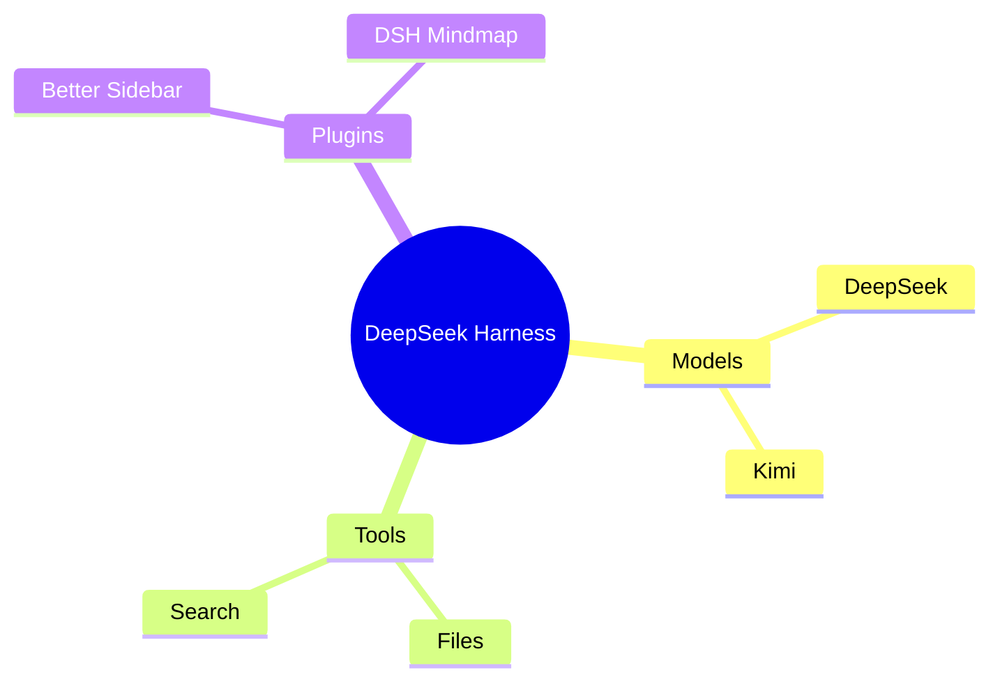

<div align="center">
  
  <h1>DSH Mindmap</h1>
  <p><strong>Turn Markdown into interactive mind maps — inside DeepSeek Harness.</strong></p>
  <p>A Markdown-first, open-source plugin for DSH Web and Better Sidebar.<br />Your <code>.md</code> file stays the source of truth.</p>
  <p>
    <a href="#quick-start">Get started</a> ·
    <a href="#how-it-works">See how it works</a> ·
    <a href="#documentation">Documentation</a> ·
    <a href="./README.vi.md">Tiếng Việt</a>
  </p>
  <p>
    
    
    <a href="./LICENSE"></a>
  </p>
</div>

---

## See DSH Mindmap in action


*Topic Taxonomy — a real-world mind map rendered from Markdown. This image shows the map output, not the full DSH Web interface.*

## Why DSH Mindmap?

**Think visually. Keep working in Markdown.** DSH Mindmap makes it easier to explore a hierarchy of notes, ideas, or project structure without converting your documents into a proprietary format.

- **Markdown-first** — use ordinary `.md` / `.markdown` files; no separate map file to maintain.
- **Integrated with Better Sidebar** — view a marked file automatically, or open any Markdown file as a mind map on demand.
- **Two views, one draft** — switch between an interactive map and an editable Markdown panel.
- **Navigation & layouts** — zoom, pan, expand/collapse branches, and choose Document, Tree, Two-sided or Org chart layout.
- **Export** — download Markdown, SVG or PNG.
- **Guarded saves** — writes go through Better Sidebar's authenticated, session-scoped routes with modification-time conflict checks.

> [!IMPORTANT]
> **Experimental (v0.1.5).** Live end-to-end verification in a DSH Web profile is not yet recorded as complete. This repository contains source code; cloning it does **not** automatically install the plugin.

## How it works

Add the `markmap: true` frontmatter to a Markdown document:

```markdown
---
markmap: true
---

# DeepSeek Harness

## Models
- DeepSeek
- Kimi

## Tools
- Files
- Search

## Plugins
- Better Sidebar
- DSH Mindmap
```

Better Sidebar opens that file with the interactive mind-map viewer. The following diagram **illustrates the example structure**; it is not a screenshot of the plugin UI:



**Want to map an existing Markdown file?** Right-click a `.md` / `.markdown` file in Better Sidebar and choose **View as Mindmap**, or use **Mindmap** from an editor action. An **Open With → Mindmap** choice may also appear, depending on the Better Sidebar UI.

Unmarked Markdown files continue to use Better Sidebar's regular viewer by default. Automatic detection currently recognizes the explicit `markmap: true` marker; a structured `markmap:` options object alone does **not** opt a file into automatic opening. You can still open it manually.

**Animated walkthrough:** not yet available. See [demo asset guidance](./assets/README.md) for how to capture a verified GIF from DSH Web.

## Quick start

**Requirements:** Node.js **24.9+**, pnpm, DSH Web **>=0.2.2-0 <0.3.0**, and a compatible **dsh-better-sidebar 0.32.x** installation (peer dependency: `^0.32.1`).

```bash
git clone https://github.com/sonhoang23/dsh-mindmap.git
cd dsh-mindmap
pnpm install
pnpm run check
```

**Only if all checks pass**, register the local source package in your DSH Web profile:

```bash
dsh plugin --profile web add .
dsh plugin --profile web install
```

Fully restart DSH Web and hard-refresh the browser. Then open a Markdown file containing `markmap: true`.

> This package is currently marked `private: true`. These are **source-install instructions**, not an npm registry installation command. See the [complete installation guide](./docs/installation.md) for compatibility checks, updates and verification.

## Use it

| Action | How |
| --- | --- |
| Auto-open a map | Put `markmap: true` in YAML frontmatter and open the Markdown file |
| Open manually | Better Sidebar file menu → **View as Mindmap** |
| Edit | Select **Markdown** in the viewer toolbar |
| Return to map | Select **Mindmap**; it uses the current in-memory draft |
| Change layout | Choose **Document**, **Tree**, **Two-sided** or **Org chart** |
| Save | Click **Lưu** (Save); the plugin checks for an external modification before writing |
| Export | Use **MD ↓**, **SVG ↓** or **PNG ↓** |

Changes in the Markdown editor are **not saved automatically**. Exporting Markdown downloads the current draft; use **Lưu** to persist changes to the source file.

## Compatibility

| Component | Requirement |
| --- | --- |
| DSH | `>=0.2.2-0 <0.3.0` |
| Better Sidebar | `^0.32.1` peer dependency |
| Node.js | `>=24.9.0` |
| UI | DSH Web |
| License | [MIT](./LICENSE) |

This is a community plugin, not an official DeepSeek Harness release.

## Documentation

- [Install, upgrade & verify](./docs/installation.md)
- [Developer guide & architecture](./docs/development.md)
- [Troubleshooting](./docs/troubleshooting.md)
- [Release notes](./CHANGELOG.md)
- [Vietnamese README / README tiếng Việt](./README.vi.md)

## Contributing

Issues, reproducible bug reports and pull requests are welcome. Before submitting changes, run `pnpm run check` and, for UI changes, verify them in a compatible DSH Web profile. Please include browser-console errors and host/plugin versions when reporting failures.

Built with [Markmap](https://markmap.js.org/) and Better Sidebar. Distributed under the [MIT License](./LICENSE).
