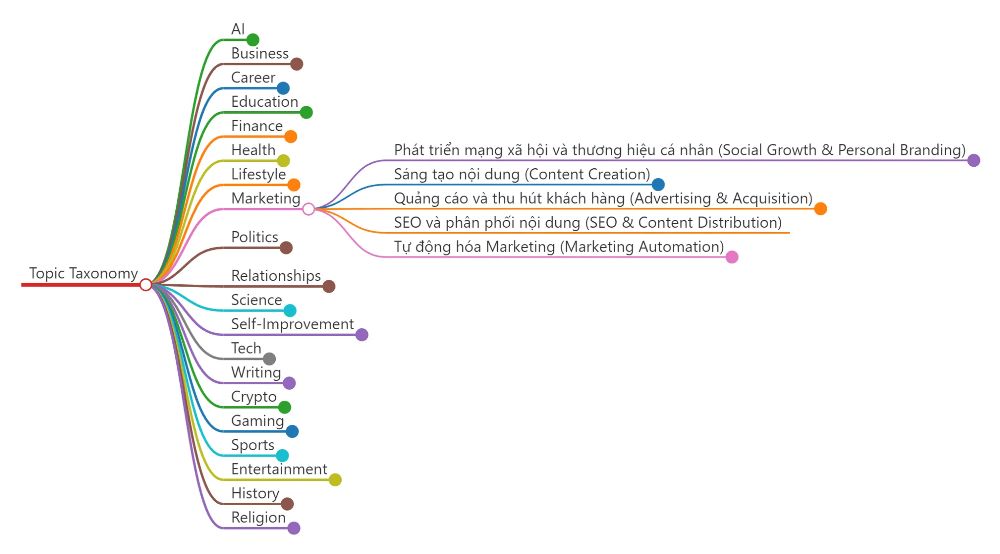
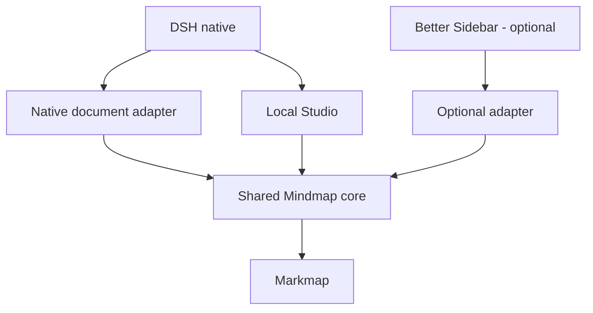

<div align="center">
  
  <h1>DSH Mindmap</h1>
  <p><strong>Turn Markdown into interactive mind maps — natively in DeepSeek Harness.</strong></p>
  <p>Native-first · Markdown-first · Better Sidebar optional</p>
  <p><a href="#quick-start">Quick start</a> · <a href="#features">Features</a> · <a href="#optional-better-sidebar">Better Sidebar</a> · <a href="./README.vi.md">Tiếng Việt</a></p>
  <p>  <a href="./LICENSE"></a></p>
</div>



*Real map output rendered from Markdown; not a screenshot of the full DSH interface.*

## Quick start

**No Better Sidebar required.** Install into DSH Web with Node.js 24.9+ and pnpm. DSH must expose the native `documentPreviews` registry (native viewing was reported working on 0.2.2-rc.5 with v0.2.1).

```bash
git clone https://github.com/sonhoang23/dsh-mindmap.git
cd dsh-mindmap
pnpm install
pnpm run check
dsh plugin --profile web add .
dsh plugin --profile web install
```

Only install after checks pass. Restart DSH Web and hard-refresh. In native **Files**, open a file named `example.mindmap.md`:

```markdown
---
markmap: true
---

# My knowledge
## AI Systems
- Models
- Harness
## Learning
- Notes
- Practice
```

The map opens automatically. Use DSH's document viewer menu to switch back to Markdown. Ordinary .md files keep the native viewer. The suffix, not frontmatter alone, selects native Mindmap.

## Features

| Feature | Native Files | Better Sidebar (optional) |
| --- | --- | --- |
| Open compound mindmap suffix | Yes | With explicit frontmatter or manual action |
| Pan, zoom, Fit, Level, layouts, wrapping | Yes | Yes |
| Viewer themes, colors, spacing, opening level, Fit presets and option warnings | Yes | Yes |
| Markdown draft editing and MD/SVG/PNG export | Yes | Yes |
| Relative Markdown links | Native resource navigation | Sidebar navigation |
| Auto-detect ordinary .md with markmap: true | Not yet | Yes |
| Save directly to source | Not yet | Yes, guarded by modification time |

**Native files are read through DSH's authenticated document preview.** Edits are in-memory drafts; exporting downloads a copy. The plugin does not add a filesystem write API. Native document files are limited to 2 MB of UTF-8 text. Mobile controls share the same map engine.

### Viewer customization

Open **Tùy chỉnh** on desktop or **⋯** on compact panels to preview themes, color schemes, branch palettes, spacing and Fit/Zoom presets. **Theo file** uses document frontmatter or Markmap defaults; viewer overrides do not change Markdown. Opening Level is a browser preference applied on the next open/reload (root depth 0); the regular Level action folds immediately. Both image exports use the effective light/dark appearance at download time. See [acceptance checks](./docs/development.md#viewer-options-acceptance).

### Mindmap Studio

Where the DSH native tab guide exposes Mindmap Studio, create or import a local Markdown file and export your draft. Native Files is the recommended workspace workflow; Studio is an additional local-file tool.

## Optional Better Sidebar

Users of Better Sidebar 0.32.x (`^0.32.1`) can keep its automatic frontmatter detection, **View as Mindmap** file action, editor action and guarded file saves. The adapter activates only when its service is present.

## Architecture



Native-first means core features must not require third-party plugins. See [AGENTS.md](./AGENTS.md) and [development](./docs/development.md).

## Compatibility and status

- DSH engine range: `>=0.2.2-0 <0.3.0`; native preview requires the document registry.
- Better Sidebar: optional `^0.32.1`.
- Node.js: `>=24.9.0`; DSH Web.
- Experimental source installation; package is private, not an npm registry release.
- v0.2.1 native opening was user-confirmed; v0.2.2 refactor needs its own live acceptance.

## Documentation

[Installation](./docs/installation.md) · [Development](./docs/development.md) · [Mobile testing](./docs/mobile-testing.md) · [Troubleshooting](./docs/troubleshooting.md) · [Changelog](./CHANGELOG.md)

Issues and pull requests welcome. Include host version, optional integration status and reproducible steps. Built with [Markmap](https://markmap.js.org/), licensed under [MIT](./LICENSE).

## Prebuilt GitHub releases

Versioned experimental tarballs are published on [GitHub Releases](https://github.com/sonhoang23/dsh-mindmap/releases) by the release workflow after the repository checks pass. Install a published `.tgz` using `dsh plugin --profile web add <tarball-url>` followed by `dsh plugin --profile web install`. The source-install instructions remain available above. Clean-profile installation of the release asset must be verified separately.
