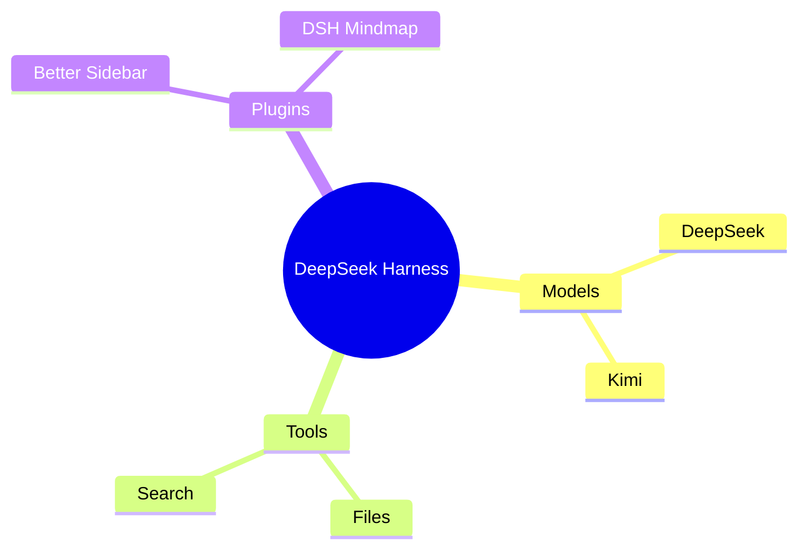

<div align="center">
  
  <h1>DSH Mindmap</h1>
  <p><strong>Biến Markdown thành sơ đồ tư duy tương tác ngay trong DeepSeek Harness.</strong></p>
  <p>Plugin mã nguồn mở theo hướng Markdown-first dành cho DSH Web và Better Sidebar.<br />File <code>.md</code> gốc vẫn là nguồn dữ liệu chính.</p>
  <p>
    <a href="#bắt-đầu-nhanh">Cài đặt</a> ·
    <a href="#cách-hoạt-động">Cách hoạt động</a> ·
    <a href="#tài-liệu">Tài liệu</a> ·
    <a href="./README.md">English</a>
  </p>
  <p>
    
    
    <a href="./LICENSE"></a>
  </p>
</div>

---

## DSH Mindmap trong thực tế


*Topic Taxonomy — sơ đồ tư duy thực tế được kết xuất từ Markdown. Ảnh thể hiện kết quả mindmap, không phải toàn bộ giao diện DSH Web.*

## Vì sao nên dùng DSH Mindmap?

**Tư duy bằng hình ảnh, lưu trữ bằng Markdown.** DSH Mindmap giúp bạn khám phá cấu trúc ghi chú, ý tưởng hay dự án mà không phải chuyển dữ liệu sang định dạng riêng.

- **Markdown là trung tâm** — làm việc với file `.md` / `.markdown` thông thường.
- **Tích hợp Better Sidebar** — tự mở thành sơ đồ khi file có đánh dấu, hoặc mở thủ công bất kỳ file Markdown nào.
- **Hai chế độ, một bản nháp** — chuyển qua lại giữa sơ đồ tương tác và trình chỉnh sửa Markdown.
- **Điều hướng và bố cục** — phóng to, thu nhỏ, kéo sơ đồ, đóng/mở nhánh; chọn Document, Tree, Two-sided hoặc Org chart.
- **Xuất dữ liệu** — tải Markdown, SVG hoặc PNG.
- **Lưu an toàn hơn** — sử dụng route đã xác thực của Better Sidebar, gắn với phiên làm việc và kiểm tra xung đột thời gian chỉnh sửa.

> [!IMPORTANT]
> **Bản thử nghiệm (v0.1.5).** Chưa có xác nhận hoàn tất kiểm thử toàn trình trên một DSH Web profile thực tế. Đưa source code lên GitHub **không có nghĩa** plugin đã được cài vào DSH trên máy bạn.

## Cách hoạt động

Thêm `markmap: true` vào YAML frontmatter của file Markdown:

```markdown
---
markmap: true
---

# DeepSeek Harness

## Models
- DeepSeek
- Kimi

## Tools
- Files
- Search

## Plugins
- Better Sidebar
- DSH Mindmap
```

Better Sidebar sẽ hiển thị file đó thành sơ đồ tư duy. Sơ đồ sau **minh họa cấu trúc nội dung**, không phải ảnh chụp giao diện plugin:



**Với file Markdown có sẵn:** nhấp chuột phải trong Better Sidebar rồi chọn **View as Mindmap**, hoặc chọn hành động **Mindmap** trong editor. Một số giao diện Better Sidebar còn hiển thị **Open With → Mindmap**.

File Markdown không đánh dấu vẫn dùng trình xem mặc định. Hiện chế độ tự nhận diện yêu cầu `markmap: true`; riêng cấu hình dạng object `markmap:` **chưa đủ để tự kích hoạt**. Bạn vẫn có thể mở thủ công.

**GIF hướng dẫn thao tác:** hiện chưa có. Xem [hướng dẫn chuẩn bị asset](./assets/README.md) để quay GIF thực tế từ DSH Web.

## Bắt đầu nhanh

**Yêu cầu:** Node.js **24.9+**, pnpm, DSH Web **>=0.2.2-0 <0.3.0** và **dsh-better-sidebar 0.32.x** tương thích (peer dependency: `^0.32.1`).

```bash
git clone https://github.com/sonhoang23/dsh-mindmap.git
cd dsh-mindmap
pnpm install
pnpm run check
```

**Chỉ khi toàn bộ kiểm tra thành công**, đăng ký plugin từ thư mục local vào profile DSH Web:

```bash
dsh plugin --profile web add .
dsh plugin --profile web install
```

Tắt và khởi động lại DSH Web hoàn toàn, sau đó hard-refresh trình duyệt. Mở file Markdown có `markmap: true` để kiểm tra.

> Package hiện đặt `private: true`, vì thế đây là hướng dẫn **cài từ source**, không phải lệnh cài từ npm. Xem [hướng dẫn cài đặt đầy đủ](./docs/installation.md).

## Cách sử dụng

| Thao tác | Cách làm |
| --- | --- |
| Tự mở thành mindmap | Thêm `markmap: true` vào YAML frontmatter rồi mở file |
| Mở thủ công | Menu file trong Better Sidebar → **View as Mindmap** |
| Chỉnh sửa | Chọn **Markdown** trên thanh công cụ |
| Xem lại sơ đồ | Chọn **Mindmap** để dựng từ bản nháp hiện tại |
| Đổi bố cục | Chọn **Document**, **Tree**, **Two-sided** hoặc **Org chart** |
| Lưu file | Nhấn **Lưu**; plugin kiểm tra file có bị sửa từ nơi khác hay không |
| Xuất file | Nhấn **MD ↓**, **SVG ↓** hoặc **PNG ↓** |

Chỉnh sửa Markdown **không tự động lưu**. Nút xuất Markdown sẽ tải bản nháp hiện tại; nhấn **Lưu** để ghi thay đổi vào file nguồn.

## Tương thích

| Thành phần | Yêu cầu |
| --- | --- |
| DSH | `>=0.2.2-0 <0.3.0` |
| Better Sidebar | Peer dependency `^0.32.1` |
| Node.js | `>=24.9.0` |
| Giao diện | DSH Web |
| Giấy phép | [MIT](./LICENSE) |

Đây là plugin cộng đồng, không phải bản phát hành chính thức của DeepSeek Harness.

## Tài liệu

- [Cài đặt, nâng cấp và kiểm tra](./docs/installation.md)
- [Phát triển và kiến trúc](./docs/development.md)
- [Xử lý lỗi thường gặp](./docs/troubleshooting.md)
- [Lịch sử cập nhật](./CHANGELOG.md)
- [README tiếng Anh](./README.md)

## Đóng góp

Bạn có thể tạo issue, gửi báo cáo lỗi có bước tái hiện hoặc mở pull request. Trước khi gửi thay đổi, hãy chạy `pnpm run check`; nếu sửa giao diện, cần kiểm tra thêm trong DSH Web tương thích. Khi báo lỗi, nên đính kèm phiên bản DSH/plugin và thông báo browser console.

Phát triển dựa trên [Markmap](https://markmap.js.org/) và Better Sidebar. Phân phối theo [giấy phép MIT](./LICENSE).
