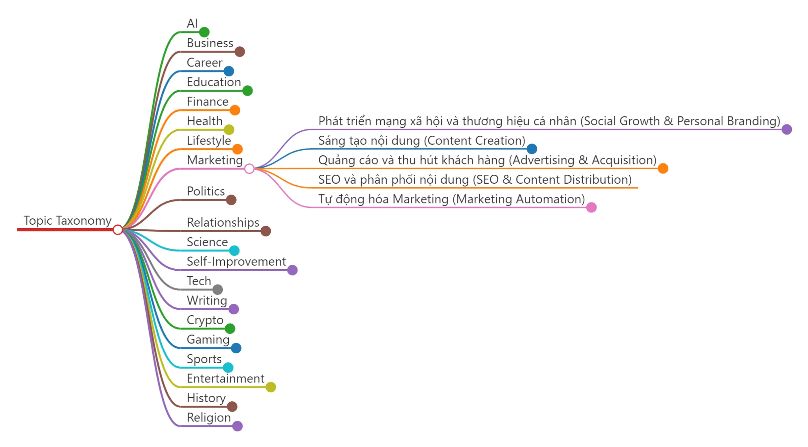
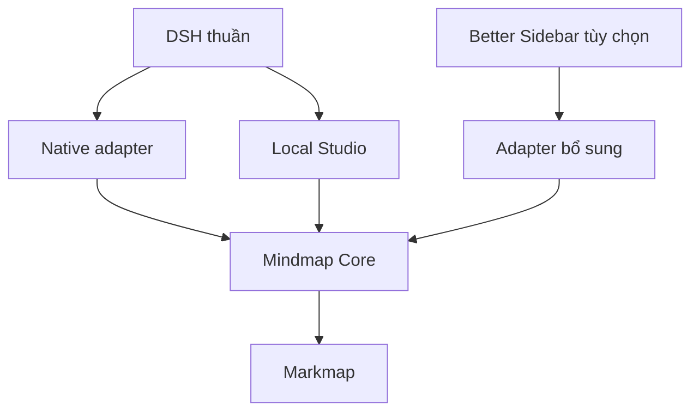

<div align="center">
  
  <h1>DSH Mindmap</h1>
  <p><strong>Biến Markdown thành sơ đồ tư duy tương tác ngay trong DeepSeek Harness.</strong></p>
  <p>Ưu tiên DSH thuần · Markdown là nguồn chính · Better Sidebar tùy chọn</p>
  <p><a href="#cài-đặt">Cài đặt</a> · <a href="#tính-năng">Tính năng</a> · <a href="#tích-hợp-better-sidebar">Better Sidebar</a> · <a href="./README.md">English</a></p>
  <p>  <a href="./LICENSE"></a></p>
</div>



*Ảnh kết quả sơ đồ thực tế từ Markdown, không phải ảnh toàn bộ giao diện DSH.*

## Cài đặt

**Không cần Better Sidebar.** Yêu cầu DSH Web có `documentPreviews`, Node.js 24.9+ và pnpm. Người dùng đã xác nhận mở Mindmap trên DSH 0.2.2-rc.5 với plugin v0.2.1.

```bash
git clone https://github.com/sonhoang23/dsh-mindmap.git
cd dsh-mindmap
pnpm install
pnpm run check
dsh plugin --profile web add .
dsh plugin --profile web install
```

Chỉ cài khi check thành công. Khởi động lại DSH Web và hard refresh. Mở **Files** mặc định rồi chọn file `example.mindmap.md`:

```markdown
---
markmap: true
---

# Kho kiến thức
## AI Systems
- Model
- Harness
## Learning
- Ghi chú
- Thực hành
```

Mindmap tự hiển thị. Có thể chuyển về Markdown bằng menu viewer của DSH. File .md thông thường vẫn giữ viewer mặc định. Native nhận diện qua đuôi file, không chỉ qua frontmatter.

## Tính năng

| Tính năng | DSH thuần | Better Sidebar (tùy chọn) |
| --- | --- | --- |
| Mở file đuôi .mindmap.md | Có | Với frontmatter hoặc mở thủ công |
| Zoom, Fit, Level, bố cục, xuống dòng | Có | Có |
| Theme, màu, khoảng cách, level khi mở, preset Fit và cảnh báo | Có | Có |
| Chỉnh sửa bản nháp và xuất MD/SVG/PNG | Có | Có |
| Liên kết Markdown tương đối | Điều hướng native | Điều hướng Sidebar |
| Tự nhận diện .md thường có markmap: true | Chưa | Có |
| Lưu trực tiếp file gốc | Chưa | Có, kiểm tra xung đột |

Native đọc nội dung qua trình xem tài liệu đã xác thực của DSH, giới hạn 2 MB văn bản UTF-8. Chỉnh sửa là bản nháp; xuất Markdown tải bản sao, không ghi đè file. Không mở thêm API ghi filesystem. Giao diện mobile dùng chung bộ hiển thị.

### Tùy chỉnh hiển thị

Mở **Tùy chỉnh** trên máy tính hoặc **⋯** trên panel nhỏ để đổi theme, chế độ màu, bảng màu nhánh, khoảng cách và preset Fit/Zoom. **Theo file** dùng frontmatter hoặc mặc định Markmap; các tùy chỉnh không sửa Markdown. Level khi mở được ghi nhớ trên trình duyệt, áp dụng lần mở/nạp tiếp theo (gốc depth 0); nút Level vẫn gập ngay. SVG và PNG dùng cùng chế độ sáng/tối tại thời điểm xuất. PNG lớn tự giảm độ phân giải để phù hợp với canvas và thử lại khi gặp lỗi canvas đã biết; dùng SVG để phóng to không mất nét. Xem [kiểm thử nghiệm thu](./docs/development.md#viewer-options-acceptance).

### Mindmap Studio

Nếu danh sách tab native có Mindmap Studio, có thể tạo hoặc import Markdown cục bộ rồi xuất bản nháp. Với workspace, nên sử dụng Files mặc định.

## Tích hợp Better Sidebar

Better Sidebar 0.32.x (`^0.32.1`) là tích hợp tùy chọn: nhận diện frontmatter, menu View as Mindmap, thao tác editor và lưu file có kiểm tra thời gian chỉnh sửa. Adapter chỉ hoạt động khi dịch vụ này có mặt.

## Kiến trúc Native First



Tính năng cốt lõi không được phụ thuộc plugin bên thứ ba. Xem [AGENTS.md](./AGENTS.md) và [hướng dẫn phát triển](./docs/development.md).

## Tương thích và trạng thái

DSH `>=0.2.2-0 <0.3.0` có document registry; Node.js `>=24.9.0`; Better Sidebar `^0.32.1` nếu sử dụng. Plugin thử nghiệm, cài từ source (chưa phát hành npm). Mở file native đã được người dùng xác nhận trên v0.2.1; v0.2.2 cần nghiệm thu lại.

## Tài liệu

[Cài đặt](./docs/installation.md) · [Phát triển](./docs/development.md) · [Mobile](./docs/mobile-testing.md) · [Xử lý lỗi](./docs/troubleshooting.md) · [Changelog](./CHANGELOG.md)

Hoan nghênh issue và pull request. Sử dụng [Markmap](https://markmap.js.org/) · giấy phép [MIT](./LICENSE).

## Bản đóng gói trên GitHub Releases

File `.tgz` thử nghiệm theo phiên bản được tạo tại [GitHub Releases](https://github.com/sonhoang23/dsh-mindmap/releases) sau khi các bước kiểm tra thành công. Có thể cài file đã phát hành bằng `dsh plugin --profile web add <tarball-url>` rồi chạy `dsh plugin --profile web install`. Vẫn có thể cài từ source như hướng dẫn trên. Cần kiểm thử cài đặt tarball trên profile sạch riêng.
